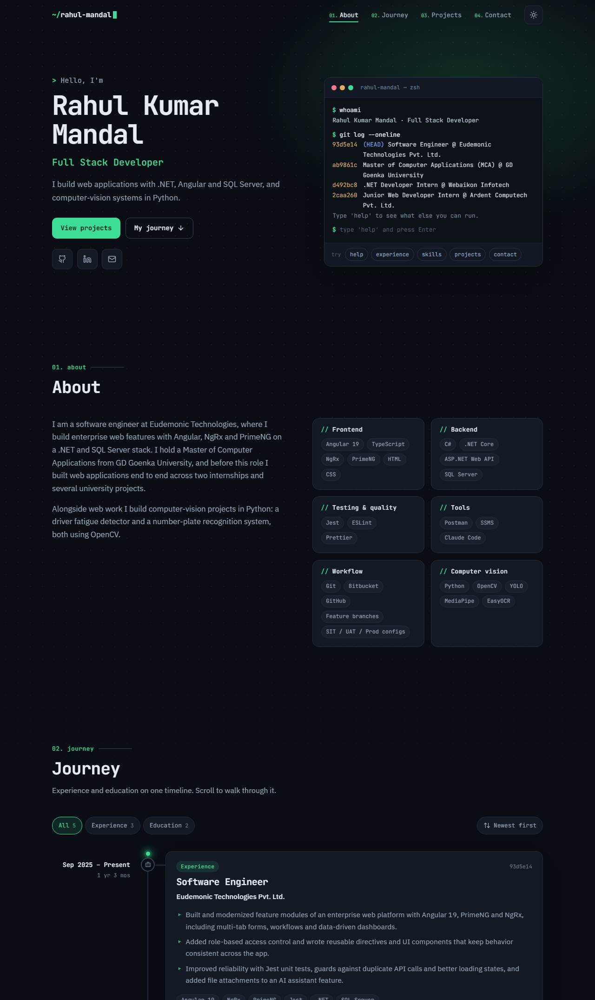

# Rahul Kumar Mandal — Portfolio

Personal portfolio built with Angular 18. Single page, prerendered to static HTML, with a scroll-driven timeline of experience and education.

**Live:** https://resume-portfolio-nu-ten.vercel.app



## Features

- **Scroll timeline** – work and education merged on one rail that fills as you scroll; entries fade in and their nodes light up as they pass. Filter by kind and flip the sort order.
- **Interactive terminal** – the hero terminal accepts commands (`help`, `experience`, `skills`, `projects`, `open vrpr`, `goto journey`, `theme`…) with Tab completion and ↑/↓ history. Its answers come from the same data file.
- **Data-driven** – every word on the page comes from one file. Add an object, get a new timeline entry or project card.
- **Dark and light themes** – follows the system setting, remembers the visitor's choice.
- **Prerendered** – the build outputs real HTML, so the page is readable without JavaScript and previews correctly when shared.
- **Responsive and accessible** – works from 320px up, keyboard friendly, respects `prefers-reduced-motion`.

## Editing content

All content lives in [`src/app/data/portfolio.data.ts`](src/app/data/portfolio.data.ts).

| To change… | Edit… |
| --- | --- |
| Name, tagline, about text, contact links | `profile` |
| Jobs, internships, school, university | `timeline` |
| Project cards | `projects` |
| Skill groups | `skills` |
| Certificates | `certificates` |

### Add a timeline entry

Append an object to `timeline`. Order does not matter; entries are sorted by `start`.

```ts
{
  id: 'acme-developer',        // any unique text
  kind: 'work',                // 'work' or 'education'
  title: 'Software Developer',
  org: 'Acme Corp',
  location: 'Bengaluru, Karnataka',
  start: '2025-08',            // 'YYYY' or 'YYYY-MM'
  // end: '2026-03',           // leave out while it is ongoing → shows "Present"
  highlights: ['What you built', 'What changed because of it'],
  tags: ['.NET', 'Angular'],
  links: [{ label: 'Code', url: 'https://github.com/…', icon: 'github' }],
},
```

### Other options

- **Résumé button** – put `resume.pdf` in `public/` and set `resumeUrl: 'resume.pdf'` in `profile`.
- **Project screenshot** – put the image in `public/` and set `image: 'file-name.png'` on the project.
- **Featured project** – set `featured: true` to give it a large card at the top.

### Terminal commands

Commands live in [`terminal.commands.ts`](src/app/sections/hero/terminal/terminal.commands.ts). To add one, add it to `COMMANDS` (so `help` lists it) and handle it in the `switch` inside `runCommand()`. New timeline entries and projects show up in the terminal without any change there.

## Development

```bash
npm install
npm start        # http://localhost:4200
npm test         # unit tests (Karma + Jasmine)
npm run build    # static site in dist/resume-portfolio/browser
```

## Deployment

`vercel.json` tells Vercel to run `npm run build` and serve `dist/resume-portfolio/browser`. In the Vercel project settings, **Root Directory** must be the repository root (empty), not `src`.

## Project structure

```
src/app/
  data/        content and its TypeScript types
  sections/    header, hero (+ terminal), about, timeline, projects, certificates, contact
  shared/      icon component, scroll-reveal directive, theme service
  utils/       date formatting helpers
```
